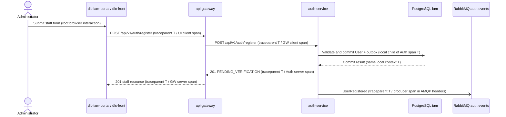

# Critical journey: administrator registers a staff account

## Scope and evidence

HU-IAM-003 lets an authenticated ADMINISTRATOR create a DENTIST or
SECRETARY_ASSISTANT. `auth-service` owns `User`, the `iam` schema and
`UserRegistered`; patients never receive accounts. A successful response is
201 with a PENDING_VERIFICATION staff resource, without session tokens.

Sources at documentation revision `71a89f6`:
- [Product backlog](https://github.com/code-corhuila/dlc-docs/blob/71a89f6/03-product/product-backlog.md)
- [Architecture](https://github.com/code-corhuila/dlc-docs/blob/71a89f6/05-architecture/overview.md)
- [Auth API](https://github.com/code-corhuila/dlc-docs/blob/71a89f6/07-api/contracts/openapi/auth-service.yaml)
- [Event catalog](https://github.com/code-corhuila/dlc-docs/blob/71a89f6/09-microservices/event-catalog.md)

## Hops

| Step | Caller | Receiver | Protocol / operation | Mode | Data / trace context |
|---|---|---|---|---|---|
| 1 | dlc-iam-portal through dlc-front HTTP capability | api-gateway | HTTPS POST /api/v1/auth/register | Sync | W3C traceparent; request body excluded from logs |
| 2 | api-gateway | auth-service | HTTP POST /api/v1/auth/register | Sync | New client span in traceparent; same trace_id; Idempotency-Key preserved |
| 3 | auth-service | PostgreSQL | Validate staff uniqueness; commit User and owner-local outbox | Sync | iam-owned records; local database child span, no HTTP header in SQL |
| 4 | Auth outbox publisher | RabbitMQ | AMQP publish UserRegistered to auth.events | Async | Stored trace context; fresh producer span in message header traceparent |

The event catalog names Audit and Analytics as consumers, without verified
runtime bindings. This map stops at publication; it does not invent a consumer
service or route identity events to the appointments/billing notification worker.
The outbox is part of Auth, not a separately owned business service.

## Sequence

The last arrow runs after commit through the outbox publisher and may occur
after the HTTP response. Store traceparent beside the outbox event in the same
transaction. Its delayed producer span keeps the original trace_id and uses
the saved Auth context as parent. Each retry gets a fresh span_id; event identity
stays stable. RabbitMQ carries the header; it does not create application spans.

## Span tree

- staff.register interaction: trace T
  - UI POST /api/v1/auth/register: CLIENT
    - api-gateway POST /api/v1/auth/register: SERVER
      - auth-service POST /api/v1/auth/register: CLIENT, gateway-owned
        - auth-service POST /api/v1/auth/register: SERVER
          - iam staff validation and transaction: CLIENT database span
          - auth.events UserRegistered publish: PRODUCER, asynchronous boundary

All spans have distinct span_id values. An incoming valid traceparent provides
the parent ID; a receiver creates its own span. Missing, malformed or zero IDs
start a new trace. Preserve sampling flags. Never put identity or tokens in baggage.

## Failure boundary and workshop coverage

Hop 2 is the dependency selected for the later incident exercise. The workshop
uses a 2-second gateway timeout as a proposed setting, not a verified deployment
configuration. A timeout does not prove that Auth rolled back; do not blindly retry.
Auth's idempotency contract must protect any deliberate retry of this command.

CP3 will instrument a minimal api-gateway module using the team's Java/Spring
stack and a controlled Auth HTTP stub. It will cover HTTP trace propagation,
JSON logs and metrics; it will not claim to implement IAM, PostgreSQL or RabbitMQ.
The successful outbox path above is a design grounded in the documentation.
