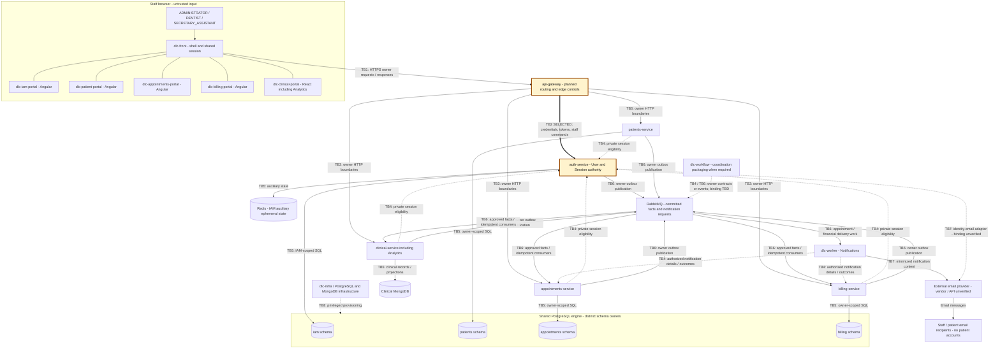

# CP1 - Di Lucca attack surface

## Scope and evidence

Selected boundary: **TB2, inbound api-gateway -> auth-service HTTP requests**;
[claim #124](https://github.com/code-corhuila/dlc-docs/issues/124).
The diagram models the documented target, not a deployed topology. Documentation
baseline: `dlc-docs` at `af9be7d`. Gateway at `dd234d4` contains only README and
CODEOWNERS. IAM feature revision `c133d6a` contains HTTP code; this does not
establish integration with Gateway or promotion to develop, qa or main.

## Data-flow diagram

Arrows summarize data exchange, including responses; they are not startup order.
TB3-TB6 label families of distinct owner boundaries, not one shared trust zone.
TB5 includes schema privileges even though PostgreSQL is physically shared.
TB4 uses private service credentials and owner checks; internal routes must not
be publicly routed. For readability, additional TB4 calls are described here:
Appointments/Clinical/Billing validate Patients; Patients/Clinical/Billing consult
Appointments; Clinical coordinates encounter charges with Billing. TB8 covers
operators/migration identities and deployment of all runtimes/stores, not staff roles.
The shell composes portals and provides HTTP/session capabilities. Patients are
data subjects and email recipients, never authenticated application users.
`dlc-workflow` is not an extra business owner or a required hop for every request.
Email delivery is documented; no named vendor, SDK endpoint or payment-provider
API is established by these sources. Dashed edges denote supporting/private
contracts or unresolved bindings, not evidence that those controls are deployed.

## Asset inventory

Classification below is the workshop assessment, not an asserted team-wide policy.

| Asset | Location / owner | Classification | Security concern |
|---|---|---|---|
| Staff password hashes | PostgreSQL iam / Auth | restricted | Offline cracking; never export to logs or clients |
| Access and refresh credentials | Protected browser transport; Auth; refresh hashes in iam | restricted | Theft, replay and stale session privileges |
| User status and role assignments | PostgreSQL iam / Auth | confidential | Unauthorized grants, unlocks or account changes |
| Session and refresh-family state | PostgreSQL iam / Auth | restricted | Revocation bypass or unsafe token rotation |
| Verification / recovery challenges | Auth transport and hashed iam records | restricted | Purpose confusion, replay or account takeover |
| Audit actor, action and correlation records | IAM audit persistence / operational logs | confidential | Disclosure, tampering or missing attribution |
| Public signing keys | Auth JWKS response | public | Public readability is intended; integrity still matters |
| Clinical records | Clinical-owned MongoDB | restricted | Unauthorized patient information disclosure |
| Invoice and payment details | PostgreSQL billing / Billing | confidential | Unauthorized financial disclosure or modification |

## Selected-boundary entry points

Paths below include the documented `/api/v1` prefix. The immediate intended
caller is Gateway, forwarding staff-browser operations; Gateway forwarding is
not implemented. Auth's HTTP port, Gateway listener and inter-service TLS setup
are unverified. No RabbitMQ queue crosses TB2; `auth.events` is a proposed topic
exchange at TB6, with facts such as `UserRegistered` and `SessionRevoked`.
Exact queue names, bindings and broker listener ports remain unverified.

| Method and path under /api/v1 | Originating caller / data | Required authentication and authorization | Inspected current evidence |
|---|---|---|---|
| POST /auth/login | Staff; email and password | Public route; password and account eligibility, lock and IP limits | LoginController exists at c133d6a; deployed controls not verified |
| POST /auth/register | Administrator; new staff details | Bearer JWT; Administrator only; no ordinary Administrator creation | Contract only in this inspection |
| GET /auth/staff; GET/PATCH /auth/staff/{id} | Administrator; staff reads/updates | Bearer JWT plus owner-side Administrator checks | Contract only in this inspection |
| POST /auth/staff/{id}/disablings, /enablings, /unlocks | Administrator; account lifecycle | Bearer JWT plus current actor/session and operation authorization | StaffUnlockController calls CurrentActorService and UnlockStaffService at c133d6a; other operations unverified |
| PUT /auth/staff/{id}/role-assignments | Administrator; allowed role changes | Bearer JWT; no ordinary ADMINISTRATOR grant; revoke affected sessions | Contract only in this inspection |
| POST /auth/refresh; POST /auth/logout | Staff browser; refresh cookie / CSRF proof | Eligible refresh cookie plus CSRF; approved origin; rotation/revocation | Contract only in this inspection |
| GET /auth/csrf | Staff browser; eligible refresh cookie | Cookie eligibility and approved origin before returning bound CSRF proof | Contract only in this inspection |
| POST /auth/email-verifications, /password-recovery-requests, /password-resets | Staff; email or single-purpose token | Public routes; purpose/expiry/single-use checks where applicable; generic recovery acknowledgement | Contract only in this inspection |
| GET /auth/sessions; POST /auth/sessions/{id}/revocations | Staff; own session metadata / revocation | Bearer JWT and ownership; no access to another staff member's sessions | Contract only in this inspection |
| GET /auth/jwks | Token verifiers; public keys | Public route; public key material only | LoginController exposes JWKS at c133d6a |

Private Auth entries `GET /internal/v1/staff/{id}/validation` and
`POST /internal/v1/sessions/validations` are adjacent service-authenticated
contracts, not public Gateway routes. They require scoped service JWTs.
Do not trust caller-supplied `X-User-Id` or `X-User-Role`; the documented design
requires Gateway sanitization and independent owner verification. That Gateway
control is pending implementation. MFA is excluded by accepted ADR-016.
Existing feature-branch tests use mocks in places; their presence is not proof
of full authorization enforcement. No application or security test was run for CP1.

## Sources

- [Architecture and data flows](https://github.com/code-corhuila/dlc-docs/blob/af9be7d/05-architecture/overview.md), [dependencies](https://github.com/code-corhuila/dlc-docs/blob/af9be7d/09-microservices/dependency-map.md), [transversal repositories](https://github.com/code-corhuila/dlc-docs/blob/af9be7d/09-microservices/transversal-repositories.md).
- [Authentication](https://github.com/code-corhuila/dlc-docs/blob/af9be7d/07-api/authentication.md), [Auth OpenAPI](https://github.com/code-corhuila/dlc-docs/blob/af9be7d/07-api/contracts/openapi/auth-service.yaml), [private contracts](https://github.com/code-corhuila/dlc-docs/blob/af9be7d/07-api/contracts/openapi/internal-coordination.yaml).
- [Auth data](https://github.com/code-corhuila/dlc-docs/blob/af9be7d/09-microservices/services/02-auth-service/data-model.md), [transport](https://github.com/code-corhuila/dlc-docs/blob/af9be7d/09-microservices/communication-patterns.md), [CP0 revision evidence](README.md#inspected-evidence).
